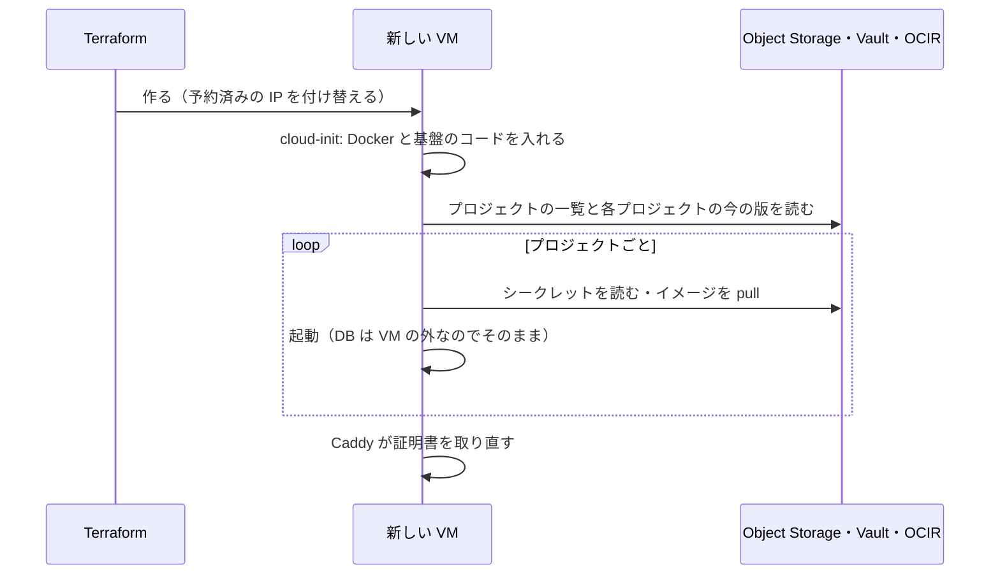

# 02 構成と決定

[01](01_purpose.md) の目的と方針に沿って決めた構成を書く。

## 1. 前提にした無料枠

無料枠の値と出典は [references/oci-free-tier.md](references/oci-free-tier.md) にある。構成を決めるのに効いたのは次の点。

- **VM**: 無料で確実に作れるのは E2.1.Micro（1/8 OCPU・1 GB）の 2 台。A1（合計 2 OCPU・12 GB）は大きいが、リージョンによっては空きが無く作れないことが多い。
- **DB**: MySQL HeatWave（1 ECPU・8 GB。ECPU は OCI の CPU の数え方の単位）が 1 個。小さなアプリを複数載せるには十分。
- **ホームリージョン**: Compute と DB は、ホームリージョンにしか無料で作れない。
- **アイドル回収**: Always Free の Compute は、7 日間使用率が低いと回収されうる。個人用のアプリはこれに当たりやすい。
- **無料でないもの**:
  - **OCI DevOps のビルド**。実行の分だけ課金される（額は未確認）。有料の資源を使うので、PAYG（従量課金）のアカウントが要る見込み（未確認）。
  - **OCIR の保存**。保存量に応じた料金になりうる。古いものを消して小さく保つ。

## 2. 全体の図

```mermaid
flowchart TB
  subgraph local["手元"]
    dev["開発: 本番と同じイメージ・同じ版の MySQL"]
    push["プロジェクトのタグを push"]
  end
  push --> gh["GitHub"] --> devops["OCI DevOps<br/>ビルド"]
  devops --> reg[("OCIR<br/>イメージ")]
  devops -->|"エージェントに afp deploy を実行させる"| afp
  user["ブラウザ"] -->|"HTTPS<br/>app-a.example.com<br/>app-b.example.net"| caddy
  subgraph vcn["VCN"]
    subgraph pub["パブリック・サブネット"]
      subgraph vm["VM（ステートレス）"]
        afp["afp"]
        caddy["Caddy<br/>入口・証明書"]
        a["プロジェクト A"]
        b["プロジェクト B"]
        caddy --> a & b
      end
    end
    subgraph priv["プライベート・サブネット"]
      mysql[("MySQL HeatWave<br/>プロジェクトごとに DB とユーザ")]
    end
  end
  a & b --> mysql
  reg -. pull .-> vm
  bastion["OCI Bastion"] -. "保守のときだけ" .-> mysql
  vault["OCI Vault"] -. "シークレット" .-> afp
  os[("Object Storage<br/>一覧・今の版・ダンプ")] -. "読み書き" .-> afp
  afp -. "基盤のヘルスチェック（1 時間ごと）" .-> mysql
  afp -. "結果" .-> mon["OCI Monitoring<br/>アラーム → メール"]
```

## 3. 部品と役目

| 部品 | 役目 |
|---|---|
| **VM**（OCI Compute） | プロジェクトのコンテナと Caddy を Docker で動かす。ビルドはしない |
| **Caddy** | 入口。HTTPS を受け、ドメイン名でプロジェクトに振り分ける。証明書（Let's Encrypt）を自動で取得・更新する |
| **`afp`** | 基盤のコマンド（Python の標準ライブラリだけで書く。§5.8）。VM の上で、初期設定・プロジェクトの一覧に合わせた同期（プロジェクトの DB とユーザの作成を含む）・デプロイ・バックアップ・基盤のヘルスチェックを受け持つ。外からは、VM の中のエージェント（Oracle Cloud Agent の Run Command）を通して呼ぶ（§5.6） |
| **MySQL HeatWave** | 全プロジェクトで共有する DB。プロジェクトごとにデータベースとユーザを分ける |
| **OCI Vault** | シークレットの置き場所。生成できる値は Terraform が生成して Vault に置く（値は Resource Manager の state にも残る） |
| **Object Storage** | プロジェクトの一覧・各プロジェクトの今の版・DB のダンプ |
| **OCIR**（OCI のコンテナ・レジストリ） | ビルドしたイメージ |
| **OCI DevOps** | 各プロジェクトのタグの push を受けてそのプロジェクトをビルドし、VM に `afp deploy` を実行させる（§5.6） |
| **OCI Monitoring・Notifications** | 基盤のヘルスチェック（§5.7）の結果を受け、失敗したり届かなくなったりしたらメールで知らせる |
| **OCI Bastion** | 手元からプライベート・サブネットの DB に入るための、一時的な入口（§5.9） |
| **Terraform**（OCI Resource Manager で実行。[references/oci-resource-manager.md](references/oci-resource-manager.md)） | VM の外のものをすべて作る。プロジェクトの一覧から、プロジェクトごとのシークレットとパイプラインも作る |

- **VM の外は Terraform、VM の中は `afp`** が受け持つ。`afp` は Terraform が書いたプロジェクトの一覧に従う。
- プロジェクトの DB とユーザは、Terraform でなく VM の `afp` が、Vault に置いた DB の管理者のパスワードで作る。
- **基盤のヘルスチェック** は、VM から HeatWave に問い合わせて基盤が動いているかを確かめること（§5.7）。コンテナが健康かを確かめる compose の `healthcheck` とは別のもの。
- デプロイに要るファイル一式（リリース一式。プロジェクトの `compose.afp.yaml` など）をどこに置くかは、DevOps のデプロイの作りを確かめて決める（未決）。
- Terraform のスタックは 2 つ。中はどちらもモジュールで分ける。
  - **base**: Terraform の destroy で消せないものだけ。コンパートメント・Vault・Vault の鍵。
  - **本体**: それ以外のすべて（ネットワーク・Bastion・HeatWave・シークレット・バケット・予約済みの IP など）。本体の destroy の前に、バケットを空にする。
  - 本体は、base の資源を名前で探す。スタックの間で値を受け渡す仕組みは作らない。
  - 本体のシークレットの名前には、作るたびに変わる接尾辞を付ける。
- **基盤の開発中は、削除を防ぐ仕組みを一切付けない**（Terraform の `prevent_destroy`・HeatWave の削除防止・コンパートメントを消せなくする設定）。
- Terraform の state は Resource Manager が預かる。手元に state を置かない。
- 環境ごとの値（プロジェクトの一覧・ドメイン・OCID など）は、この公開リポジトリに置かず、別の非公開の設定に置く。

## 4. 状態の置き場所

VM の中には失って困るものを置かない。

| 状態 | 置き場所 |
|---|---|
| アプリのデータ | MySQL HeatWave |
| シークレット | OCI Vault |
| どのプロジェクトをどのドメインで動かすか | Object Storage（Terraform が書く） |
| 各プロジェクトの今の版 | Object Storage（デプロイが成功したら `afp` が書く） |
| イメージ | OCIR |
| リリース一式 | 未決（§3） |
| 基盤のコード | この公開リポジトリ。どのタグを使うかは Object Storage に置き、VM はそのタグのコードを取る（§5.6） |
| HTTPS の証明書 | VM の中。消えたら Caddy が自動で取り直す |
| ログ | VM の中。消えてよい |

VM が消えたときは、Terraform で作り直すだけで戻る。

- IP は予約済みのものを付け替えるので、プロジェクトの DNS は変えなくてよい。予約済みの公開 IP の料金と個数の上限は未確認。

## 5. 主な決定

### 5.1 相乗り

- 少ない VM と 1 つの DB に、全プロジェクトを相乗りさせる。VM が落ちると全プロジェクトが止まる。

### 5.2 VM

- OCI Compute の VM の上で Docker を使う。OS は Oracle Linux 9。
- VM は、取れるときは A1（1 OCPU・6 GB）、取れないときは E2.1.Micro にする。どちらにするかは、管理者が Terraform の変数で決める。A1 が取れずに作れなければ、変数を替えて流し直す。自動では切り替えない。
- A1 は arm64、E2.1.Micro は amd64。イメージは、そのときの VM の CPU の種類向けにだけビルドする。VM の CPU の種類を替えたら、載っている全プロジェクトをビルドし直す。
- VM にはスワップを置く。kdump は使わない（カーネルが落ちたときの記録のために、メモリを取っておかない）。
- アイドル回収は、作り直せば戻ることで備える（§4）。わざと負荷をかけて避けることはしない。
- ビルドは VM の上でしない。

### 5.3 DB

- MySQL HeatWave の Always Free を、全プロジェクトで共有する。手元では公式の `mysql` のコンテナを本番と同じ版・同じ設定で動かす。
- HeatWave の Always Free は保守のたびに最新の版へ上がるので、手元の版を追いかける。バックアップは 1 日分しかないので、基盤が毎日ダンプを取る。
- 基盤が定期的に触る（§5.7 のヘルスチェック）。

### 5.4 入口

- Caddy を 1 つ置き、ドメイン名（TLS の SNI と HTTP の Host ヘッダ）でプロジェクトに振り分ける。パスでは分けない。
- **80 番は常に全体に開ける**。443 番は、全体に開けるか、決めた IP からだけにするかを切り替えられる。

### 5.5 シークレット

- プロジェクトのシークレットを OCI Vault に置く。VM はインスタンス・プリンシパル（VM そのものに与える権限）で読み、デプロイのたびに環境変数のファイルを作る。
- **コンテナからは、VM のメタデータ（`169.254.169.254`）への通信を、VM の初期設定で落とす**。同じ IP の 53 番（VCN の DNS）だけは通す。メタデータの古い口（v1）も止める。

### 5.6 デプロイ

- **各プロジェクトのリポジトリ** にタグ（例: `v1.2.3`）を push すると、そのプロジェクトだけをビルドし、VM でデプロイするところまで自動で行う。デプロイした版の名前は、タグの名前そのもの。
- **基盤のコードも、タグで版を決めて VM に届ける**。どのタグを使うかを Object Storage に置き、VM の `afp` はそのタグのコードを公開リポジトリから取って入れ替える。
- VM でデプロイを実行するのは、DevOps の **インスタンス・グループへのデプロイ**（AWS の CodeDeploy に当たる）。VM の中の **Oracle Cloud Agent**（OCI のイメージに入っているエージェント）の **Run Command** のプラグインが、`afp deploy <プロジェクト> <版>` を実行する（[references/oci-devops.md](references/oci-devops.md)）。
- DevOps が使えないときは、手元から同じ Run Command を直接呼んで `afp deploy` を実行させる。
- デプロイには ssh を使わない。

OCI DevOps のうち、共有するものとプロジェクトごとのものは次のとおり。

| 共有する（基盤が1つだけ持つ） | プロジェクトごと（プロジェクトの一覧から Terraform が作る） |
|---|---|
| DevOps のプロジェクト（パイプラインを入れる箱） | ビルドのパイプライン・デプロイのパイプライン |
| GitHub への接続（非公開のリポジトリを読むためのトークンは Vault に置く） | トリガー（どのリポジトリへの、タグの push で動くか） |
| 通知の宛先（成否のメール） | イメージとリリース一式の置き場所 |
| DevOps に与える OCI の権限 | — |

- **パイプラインはプロジェクトごとに独立させる**。あるプロジェクトの push は、そのプロジェクトのパイプラインだけを動かす。
- ビルドは、プロジェクトの間で並んで走ってもよい。
- VM の上のデプロイは、1 つずつ行う（`afp` がロックを取る）。後のものは前のものが終わるのを待つ。
- ビルドの手順はプロジェクトが自分のリポジトリに書く。基盤が決めるのは、ビルドの結果をどこに置くかだけ。

### 5.7 基盤の監視

- VM が定期的に（1 時間ごと）HeatWave に問い合わせ、結果を OCI Monitoring に送る。失敗したときと、届かなくなったとき（VM が止まった）にアラームでメールする。
- アプリの監視は各プロジェクトの責任とし、基盤は用意しない。

### 5.8 `afp`

- Python で書き、サブコマンドは `argparse` で作る。外部のライブラリは使わない（OCI の SDK も使わない）。VM の OS の標準の python3（3.9）で動かす。
- OCI のサービスは OCI CLI を、コンテナは `docker compose` を、DB は `mysql` のクライアントを、`subprocess` から呼ぶ。
- 使い方は `--help` に置く。

### 5.9 手元からの保守

- 手元から DB に入るときは、OCI Bastion のポート転送を使う（[references/oci-bastion.md](references/oci-bastion.md)）。
- 手元から VM に ssh で入るのは保守のときだけで、これも Bastion のポート転送を使う。22 番は外に開けない。

### 5.10 作らないもの

- 既製の PaaS（Dokku・Coolify など）・Kubernetes・Nomad
- 共通のログイン（SSO）。各アプリが自分でログインを持つ
- 自前の監視の仕組み（Prometheus など）
- ステージング環境
- 頻度の低いことを自動で見張る仕組み（DB の版のずれの検出・A1 の取り直しなど）
