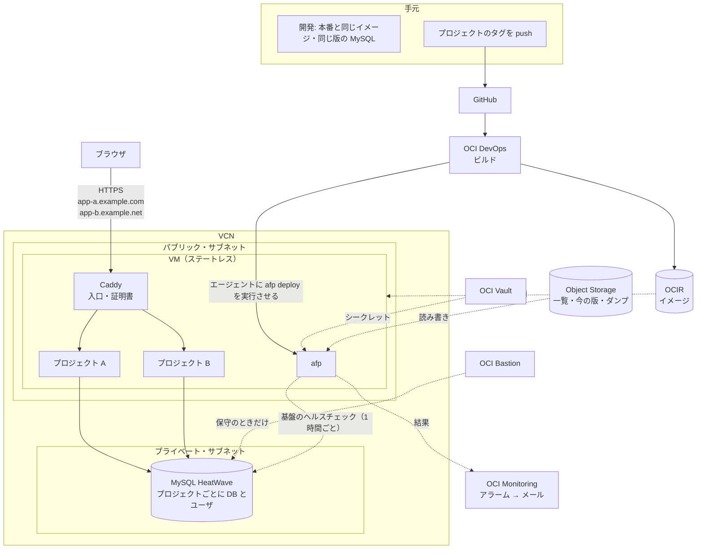
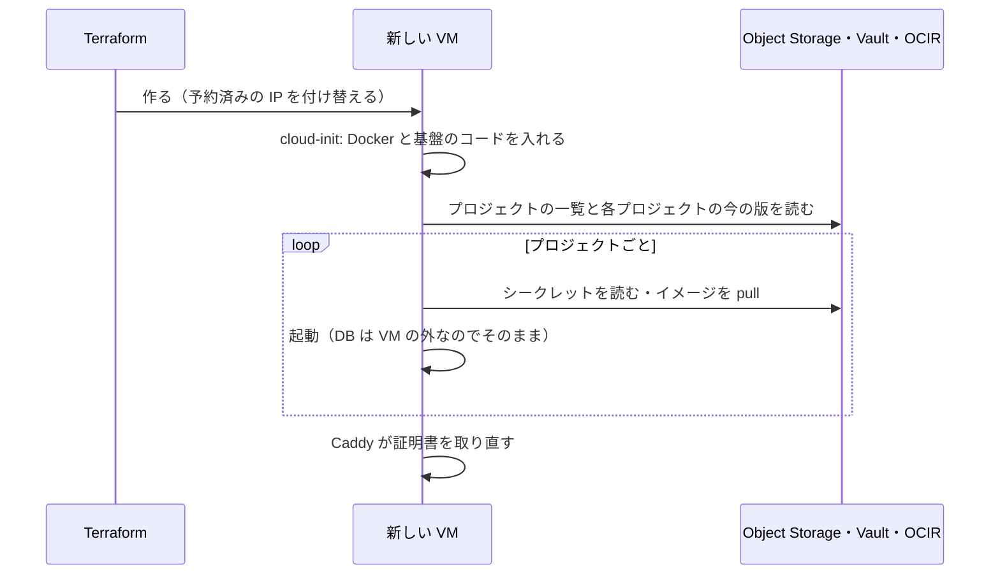

# 02 構成と決定

[01](01_purpose.md) の目的と方針から、どんな構成にしたかと、その理由を書く。

## 1. 前提にした無料枠

無料枠の値と出典は [references/oci-free-tier.md](references/oci-free-tier.md) にある。構成を決めるのに効いたのは次の点。

- **VM**: 無料で確実に作れるのは E2.1.Micro（1/8 OCPU・1 GB）の 2 台。A1（合計 2 OCPU・12 GB）は大きいが、リージョンによっては空きが無く作れないことが多い。**A1 を前提にしない**（§5.2）。
- **DB**: MySQL HeatWave（1 ECPU・8 GB。ECPU は OCI の CPU の数え方の単位）が 1 個。小さなアプリを複数載せるには十分だが、1 個しかないので共有するしかない（§5.3）。
- **ホームリージョン**: Compute と DB は、ホームリージョンにしか無料で作れない。
- **アイドル回収**: Always Free の Compute は、7 日間使用率が低いと回収されうる。個人用のアプリはこれに当たりやすい。**回収されても作り直せば戻る** ことで備え（§4）、わざと負荷をかけて避けることはしない。
- **無料でないもの**:
  - **OCI DevOps のビルド**。実行の分だけ課金される（額は未確認）。有料の資源を使うので、PAYG（従量課金）のアカウントが要る見込み（未確認）。
  - **OCIR の保存**。保存量に応じた料金になりうる。古いものを消して小さく保つ。

## 2. 全体の図

## 3. 部品と役目

| 部品 | 役目 |
|---|---|
| **VM**（OCI Compute） | プロジェクトのコンテナと Caddy を Docker で動かす。ビルドはしない |
| **Caddy** | 入口。HTTPS を受け、ドメイン名でプロジェクトに振り分ける。証明書（Let's Encrypt）を自動で取得・更新する |
| **`afp`** | 基盤のコマンド（Python の標準ライブラリだけで書く。§5.8）。VM の上で、初期設定・プロジェクトの一覧に合わせた同期（プロジェクトの DB とユーザの作成を含む）・デプロイ・バックアップ・基盤のヘルスチェックを受け持つ。外からは、VM の中のエージェント（Oracle Cloud Agent の Run Command）を通して呼ぶ（§5.6） |
| **MySQL HeatWave** | 全プロジェクトで共有する DB。プロジェクトごとにデータベースとユーザを分ける |
| **OCI Vault** | シークレットの置き場所。生成できる値は Vault が生成する |
| **Object Storage** | プロジェクトの一覧・各プロジェクトの今の版・DB のダンプ |
| **OCIR**（OCI のコンテナ・レジストリ） | ビルドしたイメージ |
| **OCI DevOps** | 各プロジェクトのタグの push を受けてそのプロジェクトをビルドし、VM に `afp deploy` を実行させる（§5.6） |
| **OCI Monitoring・Notifications** | 基盤のヘルスチェック（§5.7）の結果を受け、失敗したり届かなくなったりしたらメールで知らせる |
| **OCI Bastion** | 手元からプライベート・サブネットの DB に入るための、一時的な入口（§5.9） |
| **Terraform**（OCI Resource Manager で実行。[references/oci-resource-manager.md](references/oci-resource-manager.md)） | VM の外のものをすべて作る。プロジェクトの一覧から、プロジェクトごとのシークレットとパイプラインも作る |

- **VM の外は Terraform、VM の中は `afp`** が受け持つ。`afp` は Terraform が書いたプロジェクトの一覧に従う。
- プロジェクトの DB とユーザは、Terraform でなく VM の `afp` が、Vault に置いた DB の管理者のパスワードで作る。Terraform を実行する Resource Manager からは、プライベート・サブネットの DB に届かないため。
- **基盤のヘルスチェック** は、VM から HeatWave に問い合わせて基盤が動いているかを確かめること（§5.7）。コンテナが健康かを確かめる compose の `healthcheck` とは別のもの。
- デプロイに要るファイル一式（リリース一式。プロジェクトの `compose.afp.yaml` など）をどこに置くかは、DevOps のデプロイの作りを確かめて決める（未決）。
- Terraform のスタックは、**消せるかどうかで 2 つに分ける**。中はどちらもモジュールで分ける。
  - **base**: 消さないもの。コンパートメント・Vault・Vault の鍵。
  - **本体**: 作って壊せるもの。ネットワーク・Bastion・HeatWave・シークレットなど、base 以外のすべて。
  - **理由**: Vault は消してもすぐには消えず、数日の削除待ちの間コンパートメントの中に残る。中身の残るコンパートメントは消せない。そのため、1 つのスタックでは destroy が最後まで通らない（[references/oci-vault.md](references/oci-vault.md)）。
  - 本体は、base の資源を名前で探す。スタックの間で値を受け渡す仕組みは作らない。
  - 本体のシークレットの名前には、作るたびに変わる接尾辞を付ける。消したシークレットも削除待ちとして base の Vault に残るので、作り直したときに名前がぶつからないようにするため。
  - 採らなかった案:
    - スタックを 1 つにする: 上のとおり destroy が通らない。作るたびに、削除待ちの Vault が 1 つずつ溜まる。
    - コンパートメントだけを消せなくする: destroy すると、コンパートメントは Terraform の管理から外れて OCI に残る。作り直すと名前がぶつかるので、取り込み直す手間が毎回かかる。
    - base を Terraform の外（スクリプト）で作る: 何度流しても同じ結果になるように、自分で書く必要がある。
    - めったに変えないものと、よく変えるもの（プロジェクトの追加）で分ける: 分ける軸として、変える頻度は消せるかどうかほど効かない。
- **基盤の開発中は、削除を防ぐ仕組みを一切付けない**。本体を作って壊すのをくり返すため。Terraform の `prevent_destroy`・HeatWave の削除防止・コンパートメントを消せなくする設定のどれも使わない。
  - 本物のデータを載せるときに、消えると困るもの（base の Vault、本体の HeatWave・予約済みの IP・バケット）を `prevent_destroy` で守る。HeatWave に OCI 側の削除防止をかけられるかは未確認。
- Terraform の state は Resource Manager が預かる。手元に state を置かないので、手元の機械を失っても困らない。
- 環境ごとの値（プロジェクトの一覧・ドメイン・OCID など）は、この公開リポジトリに置かず、別の非公開の設定に置く。

## 4. 状態の置き場所

VM の中には失って困るものを置かない。

| 状態 | 置き場所 |
|---|---|
| アプリのデータ | MySQL HeatWave |
| シークレット | OCI Vault |
| どのプロジェクトをどのドメインで動かすか | Object Storage（Terraform が書く） |
| 各プロジェクトの今の版 | Object Storage（デプロイが成功したら `afp` が書く） |
| イメージ | OCIR |
| リリース一式 | 未決（§3） |
| 基盤のコード | この公開リポジトリ。どのタグを使うかは Object Storage に置き、VM はそのタグのコードを取る（§5.6） |
| HTTPS の証明書 | VM の中。消えたら Caddy が自動で取り直す |
| ログ | VM の中。消えてよい |

VM が消えたときは、Terraform で作り直すだけで戻る。

- IP は予約済みのものを付け替えるので、プロジェクトの DNS は変えなくてよい。予約済みの公開 IP の料金と個数の上限は未確認。
- Let's Encrypt には、同じ名前の組の証明書を 7 日に 5 枚までという発行の制限がある（[Rate Limits](https://letsencrypt.org/docs/rate-limits/)）。作り直しはまれなので気にしない。

## 5. 主な決定と採らなかった案

### 5.1 1 プロジェクト 1 組にせず、相乗りさせる

- **決定**: 少ない VM と1つの DB に、全プロジェクトを相乗りさせる。
- **理由**: [01](01_purpose.md) §2 のとおり、無料枠は個数で決まっており、小さなプロジェクトに 1 組ずつ使うのは無駄が大きい。
- **引き換え**: VM が落ちると全プロジェクトが止まる。個人用なので許す。

### 5.2 OKE・Container Instances でなく Compute

- **決定**: OCI Compute の VM の上で Docker を使う。VM は E2.1.Micro、OS は Oracle Linux 9 にする。
- **理由**: 無料か少額で、1 OCPU 未満を使えるのが Compute だけだった。VM をステートレスにすれば、コンテナ系のサービスの利点（VM の面倒を見なくてよい）の大半は得られる。
- **OS の理由**: DevOps から VM にデプロイさせる仕組み（§5.6）が、Oracle Linux と CentOS にしか対応していない（[references/oci-devops.md](references/oci-devops.md)）。
  - 採らなかった案: Ubuntu。apt が軽く、Docker が公式に対応し、python3 も新しいので 1 GB の VM には向く。ただし §5.6 の仕組みが使えない。
  - Oracle Linux の dnf は、1 GB でスワップが無いとメモリが尽きて落ちることがある。VM にスワップを置いて防ぐ。

| 採らなかった案 | 理由 |
|---|---|
| OKE（Kubernetes） | 無料で済ませるには A1 をノードにするしかない。1 GB の VM では Kubernetes 自体が重い。仕組みも大幅に複雑になる |
| Container Instances | x86 の無料枠が無く、最小 1 OCPU で 1 OCPU 未満が使えない。A1 が取れないと常に有料になる。中身の変更はインスタンスの再起動で反映されるので、1つに詰めると証明書が再起動のたびに消える。手元の compose と形がずれる |
| Functions | 常時動く Web アプリには向かない |

- VM の種類は Terraform の変数で替えられる（少額の E5.Flex の 1 OCPU 未満のバースト、取れれば A1）。A1 を自動で取り直し続ける仕組みは作らない。
- E2・E5 は amd64、A1 は arm64。A1 に替えるには、その VM に載る全プロジェクトのイメージが arm64 で動く必要がある。

### 5.3 DB は MySQL HeatWave

- **決定**: MySQL HeatWave の Always Free を、全プロジェクトで共有する。手元では公式の `mysql` のコンテナを本番と同じ版・同じ設定で動かす。

| 採らなかった案 | 理由 |
|---|---|
| VM の上の DB（PostgreSQL など） | VM に状態が残り、ステートレスにできない |
| Autonomous Database | 7 日使わないと止まる。手元で同じものを動かすには専用のコンテナが要り、重い（推奨 4 CPU・8 GB）うえに一部の機能が欠ける |

- HeatWave の Always Free は、保守のたびに最新の版へ上がり、バックアップは 1 日分しかない。前者は手元の版を追いかけ、後者は基盤が毎日ダンプを取って補う。
- 止まる条件は公式文書に見つからなかった。共有の DB はどのプロジェクトにも属さないので、基盤が定期的に触る（§5.7 のヘルスチェック）。

### 5.4 入口は Caddy

- **決定**: Caddy を1つ置き、ドメイン名でプロジェクトに振り分ける。
- **理由**: 証明書の取得と更新を自動で行い、プロジェクトを足しても設定が数行増えるだけで済む。
- IP は1つでも、ブラウザが送る名前（TLS の SNI と HTTP の Host ヘッダ）で振り分けられる。パスでは分けない（各アプリがベースのパスに対応しないといけないため）。
- **80 番は常に全体に開ける**。Let's Encrypt が証明書を出す前の確認（HTTP-01）と、HTTP から HTTPS への転送に使う。443 番を決めた IP からだけにしても、証明書の取得と更新は止まらない。

| 採らなかった案 | 理由 |
|---|---|
| nginx + certbot | 証明書を取る手順が別に要り、プロジェクトを足すたびに設定の差し替えが要る |
| Traefik | コンテナのラベルで自動設定でき便利だが、動きが見えにくい |
| OCI Load Balancer + OCI Certificates | Let's Encrypt の証明書を自動で更新する仕組みが別に要り、部品が増える |

### 5.5 シークレットは OCI Vault

- **決定**: プロジェクトのシークレットを OCI Vault に置く。VM はインスタンス・プリンシパル（VM そのものに与える権限）で読み、デプロイのたびに環境変数のファイルを作る。
- **理由**: VM をステートレスにするには、シークレットを VM の外に置く必要がある。同じ働きの OCI のサービスがある。
- **コンテナからは、VM のメタデータ（`169.254.169.254`）への通信を落とす**。インスタンス・プリンシパルは、メタデータに届けば VM の中の誰でも使える。そのままだと、1つのアプリが破られただけで、全プロジェクトのシークレットと DB のダンプが読まれる。Docker の既定ではコンテナから届くので、VM の初期設定で塞ぐ。メタデータの古い口（v1）も止める。

### 5.6 デプロイは各プロジェクトのタグの push から自動

- **決定**: **各プロジェクトのリポジトリ** にタグ（例: `v1.2.3`）を push すると、そのプロジェクトだけをビルドし、VM でデプロイするところまで自動で行う。デプロイした版の名前は、タグの名前そのものにする。
- **理由**:
  - 自動化が最重要。
  - デプロイの合図を、ふだんの push と分けて明示的にする。`main` への push のたびにデプロイすると、手元で確かめる前に本番に届く。
  - タグなら、本番に出した版に名前が付き、どのコミットかが後から分かる。戻すときも版の名前で指せる。
- 採らなかった案: `release` などのブランチへの push。合図にはなるが、出した版に名前が残らない。
- **基盤のコードも、タグで版を決めて VM に届ける**。どのタグを使うかを Object Storage に置き、VM の `afp` はそのタグのコードを公開リポジトリから取って入れ替える。VM を作り直さずに基盤のコードを上げられる。

**VM でデプロイを実行する仕組み**: DevOps の **インスタンス・グループへのデプロイ** を使う。AWS の CodeDeploy に当たる。

- VM の中の **Oracle Cloud Agent**（OCI のイメージに入っているエージェント）の **Run Command** のプラグインが、DevOps に言われたコマンド（`afp deploy <プロジェクト> <版>`）を実行する。
- DevOps が使えないときは、手元から同じ Run Command を直接呼んで `afp deploy` を実行させる。仕組みは 1 つで済む。
- どちらも、外から VM に入る口（ssh）を使わない。

| 採らなかった案 | 理由 |
|---|---|
| ssh で `afp deploy` を呼ぶ | 22 番を外に開けるか、デプロイのたびに Bastion のセッションを待つ必要がある。DevOps から ssh させるには鍵を DevOps に預けることになる |
| VM が Object Storage を定期的に見に行き、版が変わったらデプロイする | 外から入る口は要らないが、反映が遅れ、見に行く分の呼び出しと負荷がかかる。同じ働きの OCI のサービスがある |
- ビルドは VM の上でしない。E2.1.Micro（1 GB）ではビルドできないことがあり、VM を動かすだけの場所にしておく方が単純。

OCI DevOps のうち、共有するものとプロジェクトごとのものは次のとおり。

| 共有する（基盤が1つだけ持つ） | プロジェクトごと（プロジェクトの一覧から Terraform が作る） |
|---|---|
| DevOps のプロジェクト（パイプラインを入れる箱） | ビルドのパイプライン・デプロイのパイプライン |
| GitHub への接続（非公開のリポジトリを読むためのトークンは Vault に置く） | トリガー（どのリポジトリへの、タグの push で動くか） |
| 通知の宛先（成否のメール） | イメージとリリース一式の置き場所 |
| DevOps に与える OCI の権限 | — |

- プロジェクトがいつ push するかは、基盤には分からない。そこで **パイプラインはプロジェクトごとに独立させ**、あるプロジェクトの push は、そのプロジェクトのパイプラインだけを動かす。
- ビルドは、プロジェクトの間で並んで走ってもよい。
- VM の上のデプロイは、1つずつ行う（`afp` がロックを取る）。デプロイが重なっても、後のものは前のものが終わるのを待つだけで、互いに壊さない。
- ビルドの手順はプロジェクトが自分のリポジトリに書く。基盤が決めるのは、ビルドの結果をどこに置くかだけ。

### 5.7 基盤の監視は VM からのヘルスチェック

- **決定**: VM が定期的に（1 時間ごと）HeatWave に問い合わせ、結果を OCI Monitoring に送る。失敗したときと、届かなくなったとき（VM が止まった）にアラームでメールする。
- **理由**: 共有の DB を定期的に触ることと、VM・DB の死活の監視を1つで兼ねられる。外に新しい入口を開けなくてよい。
- アプリの監視は各プロジェクトの責任とし、基盤は用意しない。

### 5.8 `afp` は Python の標準ライブラリだけで書く

- **決定**: `afp` は Python で書き、サブコマンドは `argparse` で作る。外部のライブラリは使わない（OCI の SDK も使わない）。OCI のサービスは OCI CLI を、コンテナは `docker compose` を、DB は `mysql` のクライアントを、`subprocess` から呼ぶ。
- **理由**:
  - `afp` の仕事の大半は、プロジェクトの一覧（JSON）を読み、プロジェクトごとに分岐し、ファイルを書き、結果を確かめて戻すかを決めること。データの処理と分岐が読みやすく書ける。
  - VM なしでテストを書ける（一覧の読み方・環境変数のファイルの作り方・戻すかどうかの判断）。
  - 使い方は `--help` に置ける。文書に写さずに済む。
  - 標準ライブラリだけなら、VM に最初から入っている python3 で動き、venv も pip も要らない。

| 採らなかった案 | 理由 |
|---|---|
| bash | JSON の扱いを `jq` に頼り、エラー処理とテストが書きにくい |
| Python と外部のライブラリ（OCI の SDK など） | VM に依存を入れる手順と、その版の管理が増える |

### 5.9 手元から DB に入るのは OCI Bastion

- **決定**: 保守のために手元から DB に入るときは、OCI Bastion のポート転送を使う。使い方は [references/oci-bastion.md](references/oci-bastion.md)。
- **理由**: 無料で、DB の側に何も入れなくてよい。使うときだけセッションを作り、時間が来れば切れるので、常に開いた入口が残らない。

| 採らなかった案 | 理由 |
|---|---|
| VM を踏み台にする（`ssh -L`） | VM が無いと DB に入れない。VM の ssh を開けておく必要がある |
| DB をパブリック・サブネットに置く | DB が外から届く場所に出る |
| VPN | 部品が増える |

- 保守のために手元から VM に ssh で入るときも、Bastion のポート転送を使う。22 番は外に開けない。デプロイは ssh を使わないので（§5.6）、ssh は保守のときだけでまれ。

### 5.10 採らないもの

単純さのため、次は作らない。

- 既製の PaaS（Dokku・Coolify など）・Kubernetes・Nomad
- 共通のログイン（SSO）。各アプリが自分でログインを持つ
- 自前の監視の仕組み（Prometheus など）
- ステージング環境
- 頻度の低いことを自動で見張る仕組み（DB の版のずれの検出・A1 の取り直しなど）
