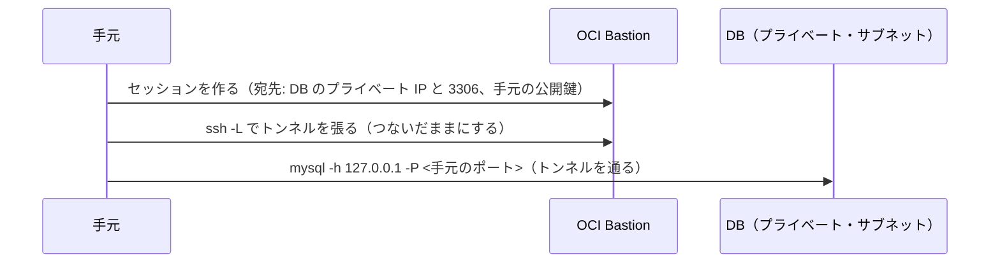

# OCI Bastion

外から直接届かない資源（プライベート・サブネットの VM や DB）に、手元から一時的に入るための OCI のサービス。踏み台のサーバを自分で立てる代わりに、OCI が用意する踏み台を使う。

- **確かめた日**: 2026-11-09（Oracle の公式文書と、実際にポート転送で MySQL に入った結果）

## 1. 要点

| 項目 | 内容 |
|---|---|
| 料金 | かからない（サービスの制限はある） |
| 範囲 | 1 つの Bastion は 1 つの VCN に結び付く。ほかの VCN の資源には届かない |
| 入れる人 | IAM のポリシーで決める。さらに、Bastion に登録した IP の範囲（client CIDR の許可リスト）からしか接続できない |
| 認証 | セッションを作るときに ssh の公開鍵を渡し、接続するときに対の秘密鍵を使う |
| 時間 | セッションは時間切れで使えなくなる。最長の時間は Bastion ごとに 30〜180 分（3 時間）で決める。時間前に消すこともできる |

## 2. セッションの種類

| 種類 | 対象に要るもの | できること |
|---|---|---|
| Managed SSH | Linux の公式イメージ・OpenSSH のサーバ・Oracle Cloud Agent と、その Bastion のプラグインの有効化 | Compute の VM に ssh で入る |
| **SSH ポート転送** | **何も要らない** | 手元のポートを、対象の決めたポートにつなぐ。MySQL・RDP など、たいていの TCP の通信に使える |
| 動的ポート転送（SOCKS5） | 何も要らない | 対象のサブネットにつなぎ、どの資源・ポートに行くかは手元で選ぶ |

## 3. ポート転送で DB に入る流れ

1. Bastion を作る。対象の VCN のサブネットと、接続を許す手元の IP の範囲を決める。
2. 対象の側のセキュリティ・リスト（または NSG）で、Bastion から対象のポート（MySQL なら 3306）への通信を許す。
   - Bastion は、対象のサブネットの中に自分の口（プライベート・エンドポイント）を置く。この口にも、**そのサブネットのセキュリティ・リストが掛かる**。
   - そのため、入る向き（ingress）だけでなく、**口から対象へ出る向き（egress）も許す** 必要がある。egress の規則が無いと、ssh のトンネルは張れるのに、対象からの応答が来ない（MySQL では接続の最初の応答を待って切れる。実測）。
3. セッションを作る。種類は「SSH ポート転送」、宛先は対象のプライベート IP とポート。手元の ssh の公開鍵を渡す。
   - CLI では `oci bastion session create-port-forwarding --bastion-id <Bastion の OCID> ...`
4. セッションの詳細に表示される ssh のコマンド（`ssh -i <秘密鍵> -N -L <手元のポート>:<対象の IP>:<対象のポート> ...` の形）を手元で実行し、つないだままにする。
5. 別のターミナルから、`127.0.0.1:<手元のポート>` に向けて接続する。

## 4. 出典

- [Bastion Overview](https://docs.oracle.com/en-us/iaas/Content/Bastion/Concepts/bastionoverview.htm)（セッションの種類・許可リスト・料金）
- [Creating an SSH Port Forwarding Session](https://docs.oracle.com/en-us/iaas/Content/Bastion/Tasks/create-session-port-forwarding.htm)（作り方・最長の時間）
